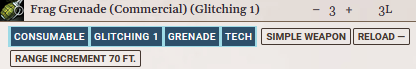

# Glitching Items

Automates the Starfinder 2e **glitching** condition on equipment. Give an item a Glitching trait, and each time it's used the module rolls the DC (5 + glitching value) flat check in chat.

**Requires:** Foundry VTT v12–v14 and the SF2e system.

## Install

In Foundry, go to **Add-on Modules → Install Module** and paste this manifest URL:

```
https://github.com/alocay/sf2e-glitching-items/releases/latest/download/module.json
```

## How to use

### 1. Tag the item

Add the **Glitching 1**, **Glitching 2** or **Glitching 3** trait to the item. The module adds these traits to the weapon and equipment trait lists. Consumables and armor get them too.



The item's name shows the value automatically, e.g. `Laser Rifle (Commercial) (Glitching 2)`, and updates when the trait changes or is removed.

### 2. Use the item

When the item posts a chat card (a Strike, Area Fire, an activation), the module rolls the flat check and posts the result:

| Result | Effect |
|---|---|
| Critical success | Works normally, and the glitching value drops by 1. |
| Success | Works normally. |
| Failure | Item penalty equal to the glitching value on checks and DCs for this use. |
| Critical failure | The item doesn't function, and the actions are lost. |

The roll result is only displayed and penalties aren't applied automatically. 
Apply them based on the result however your group sees fit.

### What counts as a use

- Every attack roll gets a check.
- Damage rolls never get a check. They're part of the Strike or Area Fire that already got one.
- Saves against the item, damage taken by targets, and cards posted by other creatures are ignored.

### Critical success

The glitching value drops by 1: Glitching 2 becomes Glitching 1, and Glitching 1 is removed.

- **Single item:** the item itself is lowered.
- **Stack of reusable items:** the used one is split off into its own stack with the lower value. The rest stay glitching.
- **Consumables (grenades):** nothing changes. The one that rolled is used up.

### Limitations

- The check is rolled after the attack card appears, so adjust the attack by hand on a failure or critical failure.
- Posting an item to chat just to show its description counts as a use.
- Shields aren't covered.

## Settings

None.

## License

MIT
