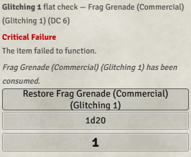
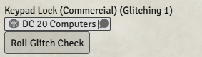

# Glitching Items

Automates the Starfinder 2e **glitching** condition on equipment. Give an item a Glitching trait, and each time it's used the module rolls the DC (5 + glitching value) flat check in chat.

**Requires:** Foundry VTT v12–v14 and the SF2e system.

## Install

In Foundry, go to **Add-on Modules → Install Module** and paste this manifest URL:

```
https://github.com/alocay/sf2e-glitching-items/releases/latest/download/module.json
```

## How to use

### 1. Tag the item

Add a **Glitching 1** to **Glitching 5** trait to the item. The module adds these traits to the weapon and equipment trait lists. Consumables and armor get them too.


The item's name shows the value automatically, e.g. `Laser Rifle (Commercial) (Glitching 2)`, and updates when the trait changes or is removed.

### 2. Use the item

When the item posts a chat card (a Strike, Area Fire, an activation), the module rolls the flat check and posts the result:

| Result | Effect |
|---|---|
| Critical success | Works normally, and the glitching value drops by 1. |
| Success | Works normally. |
| Failure | Item penalty equal to the glitching value on checks and DCs for this use. |
| Critical failure | The item doesn't function, and the actions are lost. |

The result is applied to the item's card:

- **Failure:** the DCs on the card drop by the glitching value: the save DC of an Area Fire or Auto-Fire card (e.g. `Save DC 15 basic Reflex (Glitching −1)`), and any check links from the item. Targets roll against the lower DC.
- **Critical failure:** the item's save, damage, healing and check buttons on the card are hidden from players. The GM still sees them, outlined, in case they want to override the result.
- **Critical failure on a consumable:** it's used up. The check card says "X has been consumed.", and the GM gets a **Restore** button to put it back. A consumable the system already used up (e.g. a Medpatch) isn't taken twice.



Restore works any time while the check card is in chat. It adds 1 back to the stack, or recreates the item if it was the last one.

A Strike's attack is already rolled when the check happens, so apply its penalty however your group sees fit.

### Roll Glitch Check button

When an item's check is posted to chat (e.g. a glitching keypad lock's `DC 20 Computers`), it isn't a use, so nothing rolls by itself. The card gets a **Roll Glitch Check** button instead. Anyone can click it, once per card. The result is applied to that card the same way: a failure lowers the DC, a critical failure hides the check from players, and a critical success lowers the item's glitching value.



### What counts as a use

- Every attack roll gets a check.
- Damage rolls never get a check. They're part of the Strike or Area Fire that already got one.
- Saves against the item, damage taken by targets, and cards posted by other creatures are ignored.
- Posting an item to chat just to show its description isn't a use.

### Critical success

The glitching value drops by 1: Glitching 2 becomes Glitching 1, and Glitching 1 is removed.

- **Single item:** the item itself is lowered.
- **Stack of reusable items:** the used one is split off into its own stack with the lower value. The rest stay glitching.

### Limitations

- The check is rolled after the attack card appears, so adjust a Strike's attack by hand on a failure or critical failure.
- Changing a card made by another player needs the GM online (or that player).
- Shields aren't covered.

## Settings

| Setting | Default | What it does |
|---|---|---|
| Apply glitch results to cards | On | Failure lowers the DCs on the item's card; critical failure hides the item's buttons from players (GM still sees them). Off: results are only posted in chat. |
| Consume on crit failures | On | A critical failure uses up a consumable (grenade), with a GM-only Restore button on the check card. Works whatever the setting above is. Off: the grenade stays. A Medpatch is still used up by the system, so its Restore button still appears. |

## License

MIT
